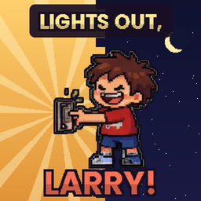

# Lights Out, Larry!

A one-button rhythm game made in Godot 4.7, with songs made in Suno.

Your annoying little brother Larry flicks the bedroom light every time you hit a note.
The room goes light and dark to the beat, funny things happen in the dark, and sooner or
later mom, dad, the sisters or the grandparents storm in to make him stop.

**▶ Play online:** https://joshuamrumack-collab.github.io/lights-out-larry/
(works on computers, and on Android and iPhone/iPad in the browser: tap anywhere to hit, tap the pause button in the corner to pause; play sideways)

## How to play
Notes slide toward the ring. Press the button when a note reaches the ring. Hold notes
need you to keep the button down. Pressing when there's no note breaks your combo.

- **Hit:** Space, Z, X, J, F, the left mouse button, or any gamepad face button
- **Pause:** Esc or Start (on touch screens: the pause button, bottom left)
- **Touch screens:** tap anywhere to hit, keep your finger down for hold notes
- **Restart:** R (while paused)
- **Change difficulty:** Left and Right in song select

## Features
- 30 songs included, each with five difficulties: Easy, Normal, Hard, Expert and Twist
  (Twist adds speed changes, mirroring and fades)
- Import your own Suno songs: choose the audio file and the game finds the beat and makes
  the charts for you. A Suno link is optional.
- Chart editor and record mode for hand-made charts, plus share codes to swap charts with friends
- Practice mode with slower speed, a start point and looping
- Daily challenge, stars, unlockable themes, replays and a score card you can save as a picture
- Optional class leaderboard through Google Sheets (see `tools/leaderboard/`)
- Accessibility: wider timing, holds as taps, big notes, any key counts, and an
  **eye tracker mode** where fewer notes come and they wait at the ring
- Four rooms (gamer, teen, cozy, spooky) and a main menu where Larry runs around the
  house flicking lights while the family chases him

## Running it
Open the folder in Godot 4.7 and press Play. The main scene is `scenes/main_menu.tscn`.

## Credits
- Music: made with Suno by DorkTeach
- Art: AI-generated pixel art
- Code: GDScript
